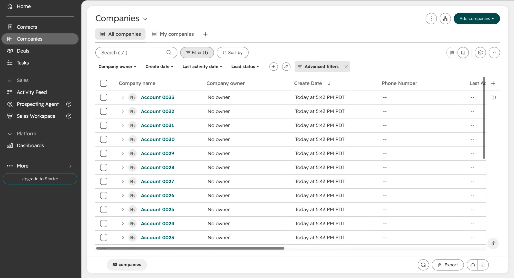

# Stack fit

How the engine's output lands in a sales team's tools. Written for Salesforce (CRM) and Outreach (sales engagement), because they are the most common pairing, with a direct API push for HubSpot.

**Status: HubSpot companies proven; Salesforce and Outreach untested.** On 2026-10-21 `make push-hubspot` wrote the 396 tier A to C accounts of the anonymized build to a HubSpot developer test account as companies (396 created), and an identical second push created 0 and updated 0. That is a test account, companies only, from the anonymized build; the private build has not been pushed, and no contacts were created. `make export` produces the Salesforce and Outreach files and they pass the engine's own checks (unique IDs, no blank required fields, no stray merge fields), but neither has been imported into a real workspace. Which tools the target sales team runs is an assumption, not a confirmed fact. Treat those import steps as a plan to verify on first use.

Both tools ask you to map each CSV column to a field during import, so the column headers are labels to map from. Changing a header, adding a field, or targeting a different tool is an edit to `export.yaml` in the vertical's config folder, not a code change.

## HubSpot: companies through the API

`make hubspot-setup` creates a "Territory Engine" property group and the custom company properties listed in the `hubspot` block of the vertical's `export.yaml`; `territory_engine_id` is created as a unique-value property. Running it again creates nothing. `make push-hubspot` then upserts one company per tier A to C account, matched on `territory_engine_id`, in batches of 100.

- **Dry run by default.** It reads what HubSpot holds and prints create / update / unchanged counts. `CONFIRM=1` writes. Unchanged companies are not sent, so a repeat push writes nothing.
- **Anonymized by default.** `SOURCE=raw` pushes the private build instead. The two builds use different IDs, so they make separate companies: use one per HubSpot account.
- **Token.** A private app token in `.env` as `HUBSPOT_TOKEN`, with the scopes listed in `.env.example`.
- **Log.** Every batch goes to `outputs/raw/hubspot_push_log.json`; the report card shows the counts of each run that wrote.
- Property names, labels and types are config. Adding a property is an edit to `export.yaml`, then `make hubspot-setup` again.

The test account after the first push, filtered to tier A: 33 companies, matching the 33 tier A accounts in the public build. The unfiltered list holds 397: the 396 pushed, plus one company that was already in the account (not checked; most likely the sample company HubSpot adds to a new account).

## Salesforce: `salesforce_accounts.csv`

One row per account in tiers A, B and C: 482 accounts in the 2026-10-13 build (after 61 accounts were left out: 48 outside the territory, 13 by review). Tier D is left out on purpose. Almost all of it is accounts with no web presence that the engine could not assess, and loading a thousand of those is clutter, not pipeline.

| CSV column | Salesforce Account field | Type | Notes |
|---|---|---|---|
| Account Name, Phone, Website | Standard fields of the same name | | |
| Billing Street, City, State/Province, Zip/Postal Code | Standard billing address | | |
| Description | Description | Long text | The plain-language score reasons |
| Territory Engine ID | Custom | Text, **External ID**, unique | Registry number or Google place ID. Match on this so re-imports update accounts and do not duplicate them. |
| Territory Tier | Custom | Picklist (A, B, C) | What list views and reports filter on |
| Territory Score | Custom | Number | 0 to 100 |
| Territory Data Coverage | Custom | Number (2 decimals) | Share of the rubric judged on real data. Low coverage means "could not find out", not "poor fit". |
| Territory Group, Territory Group Rank, Locations In Group | Custom | Text, Number, Number | Locations of one operator share a group and a rank |
| Open Roles In Area, Hiring System, Hiring Check Status, Careers Page | Custom | Number, Text, Text, URL | Blank open roles means unknown, never zero. Hiring Check Status says why. |
| Agency Type, State License, Years Registered, Found Via | Custom | Text, Text, Number, Text | State License holds the licence types the state's list shows for the matched account (for example LHCSA, CHHA). Blank means no match was found, which is not proof the account is unlicensed. |
| Signals Checked On | Custom | Date | So a rep can see how fresh the signals are |

**Import.** Create the custom fields, then use the Data Import Wizard: Accounts, "add new and update existing", match by the External ID field, map columns, start.

**Not built.**
- Parent accounts. Locations of one operator are linked only by the shared Territory Group value; no parent/child hierarchy is created.
- Contacts. The engine collects no people, so nothing is exported to Contact or Lead.
- Writing through the Salesforce API. This is a file a person imports.

## Outreach: `outreach_accounts.csv`

One row per account group in tiers A and B whose sequence passed its checks and is not out of date: 244 in the 2026-10-13 build, which is every group in tiers A and B. After a re-score, groups whose facts changed are held back until rewritten (see the runbook, "Out-of-date text").

Outreach sequences are shared templates, not one-off emails, so the per-account copy cannot be imported as a sequence. Instead the copy rides on **account custom fields**, and a single three-step sequence pulls it in:

| CSV column | Outreach Account field |
|---|---|
| Account Name, Domain, Website, Phone | Standard account fields. Domain is how Outreach matches an existing account. Every row in the 2026-10-13 build has a domain. |
| Territory Engine ID, Territory Tier, Territory Group Rank | Custom fields |
| Write To Role | Custom field. The role the copy was written for; the engine does not know who holds it. |
| Email 1 Subject, Email 1 Body, Email 2 Body | Custom fields. Greeting and sign-off are removed; the template adds them. |
| Call Opener | Custom field. A script for the rep to read, with `[their first name]` and `[your first name]` as plain words. |
| Why This Account | Custom field. The score reasons, for the rep's context. |
| Brief File | Custom field. File name of the account's brief. |

**The sequence to build once in Outreach** (insert each field from the variable picker; exact variable names differ per workspace):

| Step | Day | Type | Template |
|---|---|---|---|
| 1 | 1 | Manual email | Subject: the account's *Email 1 Subject* field. Body: "Hi" + prospect first name, the account's *Email 1 Body* field, sender first name. |
| 2 | 4 | Manual email, reply in thread | Body: prospect first name, the account's *Email 2 Body* field, sender first name. |
| 3 | 7 | Call task | Task note: the account's *Call Opener* field. |

Use manual email steps, not automatic ones, so a rep reads every draft before it sends. The engine's checks cover citations, numbers and length; they do not catch a wrong word.

**Import.** Create the custom account fields, then Actions → Bulk Create → Accounts, upload the CSV, map columns.

**Open questions to settle on first use.**
- Whether account custom fields render inside email templates in the team's Outreach plan. If they do not, the same columns can be mapped to prospect custom fields once prospects exist.
- Outreach limits the number of account custom fields; this file uses ten.
- A sequence needs prospects. The engine supplies accounts and copy, not people.

## The missing piece: contacts

Every account in the export needs a named person before a sequence can run. Sourcing them is outside the engine. The realistic routes are a contact database the team already licenses, or an enrichment workflow (for example a Clay table fed from `outreach_accounts.csv`, using the *Write To Role* column as the title to search for). Neither has been built or tested here.
